# Verbalia - Teams Meeting Scribe

## 1. Titolo e Descrizione

**Teams Meeting Scribe** è un'applicazione desktop Python per **Windows 10/11 (64-bit)** progettata per rilevare call di Microsoft Teams, registrare l'audio in doppia traccia (**microfono locale `[IO]`** + **WASAPI loopback `[ALTRI]`**), trascrivere in modalità *rolling chunk* tramite **faster-whisper**, sintetizzare la conversazione con approccio gerarchico **Map-Reduce** tramite **Ollama** e produrre automaticamente un **documento Microsoft Word (`.docx`)** professionale contenente:

1. **Bozza Mail di Recap** pronta per l'invio su Outlook (Oggetto, TL;DR, Decisioni, Next Steps);
2. **Verbale Dettagliato della Riunione** strutturato per argomenti, decisioni confermate, rischi/dipendenze e **tabella Action Items**.

Tutta l'elaborazione (acquisizione audio, normalizzazione, speech-to-text, sintesi LLM e generazione del documento Word) avviene **interamente in locale sulla macchina dell'utente**, senza inviare audio, trascrizioni o metadati a servizi cloud esterni durante il normale funzionamento.

---

## 2. Stato del Progetto e Disclaimer

- **Validazione su ambiente reale**: il progetto include una suite estesa di test automatici offline e modalità di verifica sintetica (`--dry-run`, `--test-pipeline`), ma l'acquisizione audio WASAPI loopback, i driver delle cuffie USB/Bluetooth e l'integrazione COM con Microsoft Outlook classico presentano fisiologica variabilità tra diverse postazioni Windows e devono essere verificati sull'hardware di destinazione tramite `--diagnostics`.
- **Non affiliazione**: questo progetto è un software open-source indipendente e **non è affiliato, sponsorizzato né approvato** da Microsoft Corporation (Microsoft Teams, Microsoft Outlook, Windows), da Ollama o da OpenAI / autori di Whisper e faster-whisper.

---

## 3. Funzionalità Principali

- **Bootstrap deterministico e idempotente (`bootstrap.py`)**: verifica Python e Windows, installa dipendenze mancanti con protezione anti-restart-loop, risolve o scarica FFmpeg in `bin/ffmpeg.exe`, avvia il server locale Ollama se spento, effettua il `pull` del modello configurato e salva il marker `.env_ready.json`.
- **Rilevamento euristico call Teams (`TeamsCallWatcher`)**: combina presenza processo Teams (`psutil`), sessioni audio WASAPI attive (`pycaw`), debounce iniziale di 20 secondi, titolo finestra e calendario Outlook opzionale (`win32com`) attraverso un *confidence score* pesato.
- **Grace Period intelligente (5 minuti)**: tollera cadute temporanee della call o riconnessioni di rete riprendendo nella medesima sessione senza frammentare il verbale.
- **Registrazione Dual-Track resiliente (`DualTrackChunkRecorder`)**:
  - traccia `[IO]` dal microfono predefinito e traccia `[ALTRI]` dal loopback WASAPI dell'output predefinito;
  - code *bounded* in memoria per impedire crescite incontrollate della RAM;
  - timeline monotona per traccia con compensazione controllata del silenzio;
  - rotazione automatica in chunk da 15 minuti con **overlap di 3 secondi**;
  - normalizzazione asincrona FFmpeg (`loudnorm` + ricampionamento a 16 kHz mono PCM 16-bit);
  - gestione hot-swap delle periferiche audio e prevenzione standby Windows (`SetThreadExecutionState`).
- **Trascrizione Rolling (`RollingTranscriber`)**:
  - utilizzo automatico di GPU NVIDIA CUDA (`large-v3-turbo`, `float16`) con fallback trasparente su CPU (`medium`, `int8`);
  - deduplicazione intelligente dei 3 secondi di overlap tra chunk consecutivi (`SequenceMatcher`);
  - cancellazione sicura dei file `.wav` solo dopo la verifica crittografica SHA-256 del file `.txt` trascritto;
  - rilascio esplicito della memoria RAM/VRAM di Whisper prima dell'avvio di Ollama (*SAFE mode*).
- **Sintesi Map-Reduce con Ollama (`OllamaMapReduceSummarizer`)**:
  - suddivisione del transcript unificato in finestre temporali da 30 minuti;
  - fase **MAP** con *rolling context* progressivo e cache idempotente verificata tramite hash SHA-256 di input, prompt e modello;
  - fase **REDUCE** in due passaggi distinti: Verbale Dettagliato + Bozza Mail di Recap;
  - meccanismo di *single-pass repair* in caso di output incompleto e scaricamento finale del modello (`keep_alive: 0`).
- **Generazione e Validazione Word (`MeetingDocxBuilder`)**:
  - scrittura atomica su `.tmp.docx`, riapertura e validazione strutturale completa prima della promozione in `output/`;
  - sanitizzazione rigorosa dei nomi file Windows e gestione automatica delle collisioni (`_2`, `_3`, ...).
- **Ripristino Sessioni (`--resume`) e Cleanup Sicuro (`StateManager`)**:
  - riconciliazione tra `state.json` e artefatti reali su disco per riprendere dal primo punto incompleto senza ricalcolare fasi già validate;
  - rimozione della directory temporanea consentita esclusivamente dopo la verifica positiva del `.docx` finale.
- **System Tray Nativa (`StageMonitorTray`)**: icona dinamica 64x64 generata via Pillow con codifica colore per ognuno dei 17 stati della pipeline, menu contestuale e comandi asincroni thread-safe.

---

## 4. Schema a Blocchi del Funzionamento Generale

Il diagramma seguente illustra il flusso operativo end-to-end dell'applicazione: dalla rilevazione della call, all'acquisizione audio dual-track, alla trascrizione rolling, fino alla sintesi locale LLM e alla produzione del file Word finale con pulizia sicura.

```mermaid
flowchart TD
    subgraph S1["1. Avvio e Monitoraggio Chiamata"]
        A["Avvio Applicazione (main.py)"] --> B["Verifica Ambiente (bootstrap.py / .env_ready.json)"]
        B --> C["Monitoraggio Euristico (TeamsCallWatcher)"]
        C -->|Audio Teams + Processo attivo| D{"Debounce 20 secondi superato?"}
        D -- No (Falso positivo) --> C
        D -- Sì --> E["Avvio Sessione e Metadati Outlook"]
    end

    subgraph S2["2. Registrazione Dual-Track e Normalizzazione"]
        E --> F["Acquisizione Microfono Locale [IO]"]
        E --> G["Acquisizione Loopback Altoparlanti [ALTRI]"]
        F & G --> H["Chunking Continuo (15 minuti + 3s overlap)"]
        H --> I["Normalizzazione FFmpeg (16kHz mono loudnorm)"]
    end

    subgraph S3["3. Trascrizione Rolling Whisper"]
        I --> J["Worker Trascrizione (faster-whisper GPU/CPU)"]
        J --> K["Deduplicazione Overlap 3s (transcript_utils)"]
        K --> L["Scrittura e Validazione SHA-256 chunk_NNN.txt"]
        L --> M["Cancellazione Immediata WAV (Privacy e Risparmio Disco)"]
    end

    subgraph S4["4. Conclusione Riunione e Cambio Modello"]
        M --> N{"Rilevata Fine Call?"}
        N -- Disconnessione temporanea --> O["Grace Period (300 secondi)"]
        O -- Ripresa call --> H
        O -- Scaduto --> P["Finalizzazione Tracce Audio Residue"]
        P --> Q["Unione Trascrizione Completa (merged_transcript.txt)"]
        Q --> R["Rilascio Totale Memoria Whisper (SAFE Mode gc.collect)"]
    end

    subgraph S5["5. Sintesi Locale Map-Reduce (Ollama)"]
        R --> S["Fase MAP: Analisi blocchi 30 min con Rolling Context"]
        S --> T["Fase REDUCE 1: Verbale Dettagliato a 8 sezioni"]
        T --> U["Fase REDUCE 2: Bozza Email di Recap"]
        U --> V["Scarico Modello Ollama (keep_alive: 0)"]
    end

    subgraph S6["6. Generazione Documento Word e Cleanup"]
        V --> W["MeetingDocxBuilder: Composizione Documento Word"]
        W --> X["Scrittura Atomica .tmp.docx e Tabella Action Items"]
        X --> Y{"Validazione Integrità DOCX superata?"}
        Y -- Fallita --> Z1["Errore: Preservazione Cartella Sessione per --resume"]
        Y -- Riuscita --> Z2["Promozione Definitiva in output/"]
        Z2 --> Z3["Cleanup Sicuro Cartella Temporanea temp/session_*"]
        Z3 --> Z4["Notifica Desktop e Icona Tray COMPLETED"]
    end
```



### Dettaglio dei Flussi Chiave

1. **Rilevamento Euristico**: il modulo [TeamsCallWatcher](file:///C:/Users/andrea.campisi/Desktop/AGY/teams_meeting_scribe_spec/modules/watcher.py) calcola un *confidence score* pesato incrociando l'attività audio WASAPI di Teams, la presenza del processo e il titolo della finestra. Un timer di **debounce di 20s** evita falsi positivi causati da notifiche o brevi squilli.
2. **Dual-Track & Ring Buffer**: [DualTrackRecorder](file:///C:/Users/andrea.campisi/Desktop/AGY/teams_meeting_scribe_spec/modules/recorder.py) acquisisce in parallelo microfono locale e altoparlanti remoti garantendo la totale separazione degli interlocutori (`[IO]` vs `[ALTRI]`).
3. **Pipeline Rolling & Privacy**: mentre la riunione prosegue, i chunk audio normalizzati da 15 minuti vengono trascritti progressivamente da [RollingTranscriber](file:///C:/Users/andrea.campisi/Desktop/AGY/teams_meeting_scribe_spec/modules/transcriber.py); ogni traccia audio viene **cancellata immediatamente** dal disco una volta che il corrispondente file `.txt` è stato verificato crittograficamente per SHA-256.
4. **SAFE Memory Mode**: Whisper viene deallocato con `gc.collect()` esplicito nello stage `releasing_whisper` prima che Ollama esegua l'inferenza LLM, garantendo compatibilità anche su postazioni con 8-16 GB di RAM condivisa.
5. **Sintesi Gerarchica Map-Reduce**: [OllamaMapReduceSummarizer](file:///C:/Users/andrea.campisi/Desktop/AGY/teams_meeting_scribe_spec/modules/summarizer.py) sintetizza blocchi temporali da 30 minuti con rolling context per prevenire allucinazioni o perdita di contesto, consolidando poi le decisioni e gli Action Items nel verbale finale a 8 sezioni e nella bozza email.
6. **Validazione & Cleanup Condizionato**: [MeetingDocxBuilder](file:///C:/Users/andrea.campisi/Desktop/AGY/teams_meeting_scribe_spec/modules/docx_builder.py) assembla il file `.docx` aziendale con stili professionali e tabella Action Items; [StateManager](file:///C:/Users/andrea.campisi/Desktop/AGY/teams_meeting_scribe_spec/modules/state_manager.py) rimuove la cartella temporanea della sessione **soltanto** dopo aver validato il documento finale generato in `output/`.

---

## 5. Architettura Software dei Moduli

```mermaid
flowchart TD
    CLI["main.py (CLI & Bootstrap)"] --> BOOT["bootstrap.py (.env_ready.json)"]
    BOOT --> ORCH["MeetingScribeApplication (modules/orchestrator.py)"]

    ORCH --> TRAY["StageMonitorTray (modules/tray_ui.py)"]
    ORCH --> WATCH["TeamsCallWatcher (modules/watcher.py)"]
    ORCH --> STATE["StateManager (modules/state_manager.py)"]

    WATCH -->|Confidence Score + Debounce| REC["DualTrackChunkRecorder (modules/recorder.py)"]
    WATCH -.->|COM Calendar (opzionale)| OUTLOOK["Microsoft Outlook Locale"]

    REC -->|Mic PCM| CHUNK["Chunk 15m + Overlap 3s"]
    REC -->|WASAPI Loopback PCM| CHUNK
    CHUNK -->|FFmpeg loudnorm 16kHz mono| WAV16["chunk_NNN_io_16k.wav / altri_16k.wav"]

    WAV16 --> WHISPER["RollingTranscriber (faster-whisper)"]
    WHISPER -->|Verifica SHA-256 + Delete WAV| TXT["transcripts/chunk_NNN.txt"]
    TXT --> MERGE["Deduplicazione Overlap & Merge (modules/transcript_utils.py)"]
    MERGE --> MERGED["transcripts/merged_transcript.txt"]

    MERGED -->|Rilascio VRAM Whisper| MAP["Ollama MAP (finestre 30 min + Rolling Context)"]
    MAP --> REDUCE_DET["Ollama REDUCE: Verbale Dettagliato"]
    REDUCE_DET --> REDUCE_MAIL["Ollama REDUCE: Bozza Mail di Recap"]

    REDUCE_DET --> DOCX["MeetingDocxBuilder (modules/docx_builder.py)"]
    REDUCE_MAIL --> DOCX
    DOCX -->|Validazione .tmp.docx + os.replace| OUT["output/YYYY-MM-DD_HH-MM_Titolo_Recap.docx"]
    OUT -->|Cleanup condizionato| CLEAN["Rimozione temp/session_<id>"]
```

---

## 6. Requisiti di Sistema

- **Sistema Operativo**: Windows 10 o Windows 11 a 64-bit.
- **Python**: Python `3.10`, `3.11` o `3.12` (64-bit).
- **Ollama**: installato localmente (`https://ollama.com`) con possibilità di scaricare il modello `llama3.1:8b` (o altro modello configurato in `config.py`).
- **FFmpeg**: risolto automaticamente dal bootstrap nel `PATH`, in `bin/ffmpeg.exe`, tramite `winget` (`Gyan.FFmpeg`) o download automatico HTTPS.
- **Microsoft Outlook**: opzionale (richiede Outlook Desktop classico con supporto MAPI COM; se assente o se si usa il nuovo Outlook Web/UWP, il sistema utilizza automaticamente il fallback `Riunione Teams`).
- **RAM**: minimo 16 GB raccomandati (8 GB minimi in modalità SAFE CPU).
- **GPU (Opzionale)**: scheda NVIDIA con supporto CUDA e almeno 6-8 GB di VRAM per l'accelerazione `large-v3-turbo` (`float16`). In assenza di GPU compatibile, l'applicazione passa automaticamente a CPU (`medium`, `int8`).
- **Spazio su Disco**: almeno 10 GB liberi per modelli AI, binari FFmpeg e buffer temporanei di sessione.
- **Policy Aziendali**: verificare sempre di disporre delle autorizzazioni legali e aziendali prima di registrare qualsiasi riunione.

---

## 7. Installazione Rapida

```powershell
git clone https://github.com/<owner>/teams_meeting_scribe.git
cd teams_meeting_scribe
python main.py --setup-only
python main.py
```

Il comando `python main.py --setup-only` esegue la verifica completa dell'ambiente, installa i pacchetti Python richiesti, configura FFmpeg, verifica il servizio Ollama, scarica il modello LLM e valida l'inizializzazione di Whisper salvando il marker `.env_ready.json`.

---

## 8. Utilizzo con Virtual Environment (Facoltativo ma Consigliato)

```powershell
python -m venv .venv
.venv\Scripts\Activate.ps1
python -m pip install --upgrade pip
python main.py --setup-only
python main.py
```

Quando eseguito all'interno di un virtual environment attivo, il bootstrap installa i pacchetti direttamente nell'ambiente isolato senza utilizzare il flag `--user`.

---

## 9. Modalità CLI Disponibili

Tutte le modalità operative principali sono mutuamente esclusive:

| Comando | Descrizione |
| :--- | :--- |
| `python main.py` oppure `python main.py --auto` | Avvia l'applicazione in background con icona nella System Tray e watcher automatico delle call Microsoft Teams. |
| `python main.py --setup-only` | Esegue esclusivamente il bootstrap dell'ambiente, valida FFmpeg/Ollama/Whisper, scrive `.env_ready.json` e termina. |
| `python main.py --record-now` | Avvia immediatamente una sessione di registrazione manuale bypassando l'attesa del watcher Teams. |
| `python main.py --resume <session_dir>` | Riconcilia `state.json` con gli artefatti presenti in `<session_dir>` e riprende la pipeline dal primo step incompleto. |
| `python main.py --test-pipeline <audio_file>` | Esegue l'intera pipeline reale (split chunk, FFmpeg, Whisper, Merge, Ollama MAP/REDUCE, DOCX, validazione e cleanup) su una copia del file audio indicato senza mai modificare o cancellare l'originale. |
| `python main.py --dry-run` | Esegue un test completo dell'architettura (State Machine, Tray, chunk sintetici, transcript sintetico, MAP/REDUCE sintetici, generazione e validazione reale del `.docx` e cleanup) senza aprire microfono, loopback, Teams, Outlook, Whisper o Ollama. |
| `python main.py --diagnostics` | Stampa a schermo un report diagnostico completo dell'ambiente hardware/software (compresa la quota del modello LLM su GPU) senza esporre dati sensibili. |
| `python main.py --dashboard [--tab cruscotto\|storico\|impostazioni]` | Apre il cruscotto Tkinter in una finestra separata (istanza singola). Lo stesso cruscotto si apre dalla tray con "Apri Cruscotto" e "Impostazioni". |

`--auto` e `--record-now` usano un mutex di sistema (`Local\teams_meeting_scribe`): una seconda istanza registrante viene rifiutata.

### Codici di Uscita (Exit Codes)
- `0`: Esecuzione completata con successo.
- `1`: Errore applicativo generico durante l'esecuzione.
- `2`: Argomenti da riga di comando non validi o file/directory inesistenti.
- `3`: Fallimento durante la fase di bootstrap (`BootstrapError`).
- `4`: Dipendenza esterna critica assente o non avviabile (`FFmpeg` / `Ollama`).
- `5`: Sessione indicata a `--resume` corrotta o non recuperabile (`ResumeError`).
- `6`: Documento `.docx` generato e validato correttamente, ma fallimento nella pulizia finale della cartella temporanea.

---

## 10. Interfaccia System Tray

Durante l'esecuzione, l'icona nella barra delle applicazioni di Windows mostra uno stato composito: la registrazione in corso ha la precedenza, altrimenti viene mostrato lo stage del job in elaborazione. Un badge viola riporta il numero di job attivi (in coda o in elaborazione).

| Stage | Colore Icona | Significato |
| :--- | :--- | :--- |
| `IDLE` | Grigio / Blu | In attesa dell'avvio di una call Microsoft Teams |
| `START_DEBOUNCE` | Blu | Attività audio rilevata, verifica stabilità call in corso (20s) |
| `RECORDING` | Rosso | Registrazione dual-track attiva |
| `RECORDING_AND_TRANSCRIBING` | Rosso + Anello Ciano | Registrazione attiva con trascrizione Whisper del chunk precedente |
| `GRACE_PERIOD` | Ambra | Call sospesa: finestra di tolleranza (5 min) prima della chiusura |
| `FINALIZING_AUDIO` | Arancione | Chiusura stream e normalizzazione FFmpeg dell'ultimo chunk |
| `QUEUED` | Grigio + Anello Viola | Sessione registrata, in coda di elaborazione |
| `TRANSCRIBING_FINAL` | Ciano | Completamento trascrizione degli ultimi chunk in coda |
| `RELEASING_WHISPER` | Blu Scuro | Rilascio memoria Whisper (solo dry-run: con il motore condiviso non serve più) |
| `SUMMARIZING_MAP` | Viola | Analisi MAP dei blocchi da 10 minuti tramite Ollama |
| `SUMMARIZING_REDUCE` | Viola + Oro | Generazione Verbale Dettagliato e Bozza Mail tramite Ollama |
| `BUILDING_DOCX` | Arancione | Costruzione del file Microsoft Word `.docx` |
| `VERIFYING_DOCX` | Arancione + Badge Bianco | Verifica strutturale del documento Word generato |
| `CLEANING_UP` | Verde Chiaro | Rimozione sicura dei file temporanei di sessione |
| `COMPLETED` | Verde Smeraldo | Verbale pronto nella cartella `output/` |
| `ERROR` | Rosso + X | Errore rilevato (i file temporanei sono preservati per `--resume`) |
| `SHUTTING_DOWN` | Grigio Scuro | Chiusura ordinata dei thread e salvataggio stato |

### Voci del Menu Contestuale
- `<Stato corrente>` (voce informativa non cliccabile)
- **Avvia Registrazione Manuale Ora** (abilitata ogni volta che non c'è una registrazione attiva, anche durante l'elaborazione)
- **Termina Call e Genera Recap Ora**
- **Apri Cruscotto** (anche con doppio clic sull'icona)
- **Impostazioni**
- **Apri Ultimo File Word**
- **Apri Cartella Output** (apre la cartella di oggi, se esiste)
- **Mostra Log**
- **Esci**

### Cruscotto (`--dashboard`)
Processo separato in Tkinter che legge lo storico SQLite ogni secondo:
- **Cruscotto**: stato del watcher (con timer di registrazione), quota del modello LLM su GPU, modelli, coda; tabella dei job attivi con fase, avanzamento (es. `MAP 3/6 · 812 token`), tempo in fase e tempo totale; pipeline Registrazione → Normalizzazione → Trascrizione → MAP → REDUCE → DOCX → Pulizia con ultimi eventi ed errori; pulsanti Avvia registrazione manuale, Termina call ora, Riprova, Apri DOCX, Apri cartella.
- **Storico**: filtri per giorno, periodo, esito e testo, righe raggruppate per giorno, timeline delle fasi con doppio clic, Riprocessa (se la cartella di sessione esiste ancora), Esporta CSV, importazione una tantum dello storico da `logs/app.log`.
- **Impostazioni**: modulo a gruppi salvato in `settings.json`, con Test Ollama e Verifica GPU; i campi marcati "(riavvio)" hanno effetto al prossimo avvio.

---

## 11. Configurazione (`config.py` e `settings.json`)

I default sono centralizzati e tipizzati in `config.py`; le impostazioni modificabili dall'utente stanno in `settings.json` (scritto dal cruscotto, scheda Impostazioni) e vengono fotografate all'avvio di ogni sessione o job.

- **Audio e Chunking**: `CHUNK_DURATION_SEC = 900` (15 minuti), `CHUNK_OVERLAP_SEC = 3`, `MAX_SESSION_DURATION_SEC = 14400` (4 ore), `TARGET_SAMPLE_RATE = 16000`.
- **Watcher Teams**: `START_DEBOUNCE_SEC = 20`, `STOP_GRACE_PERIOD_SEC = 90`, `TEAMS_CONFIDENCE_THRESHOLD = 0.70`, `WATCHER_USE_MIC_SIGNAL = True` (la call resta attiva finché Teams usa il microfono, anche in silenzio), `OUTLOOK_MATCH_TOLERANCE_MIN = 10` (un meeting futuro viene abbinato solo se inizia entro 10 minuti; il meeting in corso ha la priorità).
- **Whisper (CPU)**: `WHISPER_CPU_MODEL = "medium"` (`int8`, in alternativa `large-v3-turbo`), `WHISPER_CPU_THREADS = 6`, `WHISPER_LANGUAGE = "it"`, `WHISPER_BEAM_SIZE = 5`. Il tentativo CUDA avviene solo se CTranslate2 vede una GPU NVIDIA. Un unico motore condiviso serve tutte le sessioni e scarica il modello dopo `WHISPER_ENGINE_IDLE_UNLOAD_SEC = 600` secondi di inattività.
- **Ollama**: `OLLAMA_MODEL = "llama3.1:8b"`, `OLLAMA_NUM_CTX = 16384`, `OLLAMA_NUM_PREDICT_MAP = 3072`, `OLLAMA_NUM_PREDICT_REDUCE = 4096`, `MAP_BLOCK_DURATION_SEC = 600`, `OLLAMA_DETAIL_LEVEL = "dettagliato"`, streaming attivo (`OLLAMA_READ_TIMEOUT_SEC = 300` è il silenzio massimo tra due chunk della risposta).
- **Esecuzione**: `AI_PARALLEL_POLICY = "auto"` (Whisper e LLM in parallelo solo se il modello LLM risulta caricato su GPU), `PROCESSING_MAX_ATTEMPTS = 3` con backoff a partire da `PROCESSING_RETRY_BASE_DELAY_SEC = 60`.
- **Output**: `OUTPUT_ORGANIZE_BY_DAY = True`, `DOCX_INCLUDE_TRANSCRIPT = True`, `USER_DISPLAY_NAME` (nome mostrato per la traccia `[IO]`).
- **Glossario Aziendale (`CUSTOM_GLOSSARY`)**: vuoto per default; se valorizzato (anche da Impostazioni) è passato come `initial_prompt` a Whisper e inserito nei prompt di Ollama. Se è vuoto viene omesso.
- **Logging e Privacy**: `LOG_LEVEL = "INFO"`, `LOG_TRANSCRIPT_CONTENT = False`, `REQUIRE_MANUAL_CONFIRMATION_FOR_FIRST_RECORDING = True`.

### Registrazione durante l'elaborazione
Al termine di una call la cattura viene fermata subito e la sessione passa in una coda FIFO servita da un solo worker: il watcher torna immediatamente in attesa e una call ravvicinata viene registrata mentre la precedente è ancora in trascrizione o sintesi. Le elaborazioni restano sequenziali per non contendere RAM e GPU. Un errore di elaborazione resta confinato alla propria sessione: il job viene ritentato fino a 3 volte e poi parcheggiato, in attesa di "Riprova" dal cruscotto.

### Verbale e output per giorno
Il verbale contiene la bozza mail, il verbale dettagliato e, in appendice, la **trascrizione integrale** (`[hh:mm:ss] Nome: testo`). Il "Resoconto dettagliato per argomento" è composto unendo i resoconti dei blocchi MAP da 10 minuti, senza una seconda sintesi; l'LLM produce in REDUCE solo Executive Summary e liste consolidate (decisioni, questioni aperte, rischi, dipendenze, action items), con REDUCE gerarchico per le call molto lunghe. I file vengono salvati in `output/AAAA-MM-GG/AAAA-MM-GG_HH-MM_<Titolo>_Recap.docx` (giorno di inizio call); all'avvio i DOCX rimasti nella radice di `output/` vengono spostati nella cartella del loro giorno.

### GPU per Ollama (Intel Arc integrata)
Ollama vede la Arc via Vulkan ma per default scarta le GPU integrate (`server.log`: *"dropping integrated GPU; to enable, set OLLAMA_IGPU_ENABLE=1"*). Per abilitarla:

```powershell
setx OLLAMA_IGPU_ENABLE 1
# chiudere e riaprire l'app di Ollama dalla tray, poi:
ollama run llama3.1:8b "ciao"
ollama ps                          # la colonna PROCESSOR deve indicare GPU
python main.py --diagnostics       # "LLM su GPU" deve mostrare una quota > 0%
```

Opzionali, da valutare con un benchmark: `setx OLLAMA_FLASH_ATTENTION 1` e `setx OLLAMA_KV_CACHE_TYPE q8_0`. Quando è l'app ad avviare `ollama serve`, `OLLAMA_IGPU_ENABLE=1` è già incluso nell'ambiente del processo. Dopo il primo MAP la quota su GPU viene misurata e, se è 0%, la tray mostra una notifica con il rimedio.

**Piano B**: se Vulkan sulla iGPU risultasse instabile o più lento della CPU, si può usare la build portable di Ollama distribuita da IPEX-LLM (backend SYCL per GPU Intel) puntando `OLLAMA_BASE_URL`/URL Ollama delle impostazioni al suo server.

---

## 12. Diagnostica dell'Ambiente

Per verificare rapidamente lo stato dei componenti locali, delle periferiche audio WASAPI e di Ollama:

```powershell
python main.py --diagnostics
python -m pyaudiowpatch
ollama list
ollama ps
```

Il comando `python main.py --diagnostics` verifica la scrivibilità delle directory (`bin/`, `logs/`, `temp/`, `output/`), lo spazio disco residuo, la versione di FFmpeg, la raggiungibilità di Ollama, la presenza del modello configurato e la sua quota in VRAM (`/api/ps`), le periferiche di input/loopback predefinite, la disponibilità di Outlook COM e di tkinter, i percorsi di `settings.json` e dello storico `data/history.db`.

---

## 13. Privacy e Responsabilità dell'Utente

- **Nessun Upload Cloud Intenzionale**: durante l'uso operativo, audio, trascrizioni, metadati del calendario e riassunti vengono elaborati esclusivamente in locale (`localhost`). L'unico traffico di rete previsto riguarda la fase iniziale di setup (scaricamento pacchetti `pip`, eventuale download di FFmpeg o `ollama pull` del modello).
- **Gestione dei File Temporanei**: i file `.wav` vengono rimossi subito dopo la validazione di ciascun chunk trascritto; l'intera directory `temp/session_<id>/` viene eliminata automaticamente non appena il documento `.docx` finale supera la validazione.
- **Log Tecnici Sanitizzati**: i file in `logs/` non contengono mai il testo delle conversazioni, l'agenda della riunione né i nomi dei partecipanti.
- **Consenso e Conformità Normativa**: al primo avvio di una registrazione viene richiesto all'utente di confermare l'avviso privacy locale (memorizzato in `.user_consent.json`). Resta esclusiva responsabilità dell'utente informare i partecipanti alla riunione e rispettare le policy aziendali e le normative vigenti (es. GDPR, normative sul lavoro).

---

## 14. Threat Model

| Asset / Componente | Rischi Potenziali | Mitigazioni Implementate |
| :--- | :--- | :--- |
| **Audio acquisito (`temp/.../audio/`)** | Accesso locale non autorizzato a file `.wav` residui | Eliminazione immediata del `.wav` di ogni chunk dopo verifica SHA-256 del relativo `.txt`; cleanup completo a fine sessione. |
| **Artefatti intermedi (`temp/.../transcripts/`, `maps/`, `reduce/`)** | Persistenza su disco dopo crash di sistema | Confine in `temp/session_<id>/` ignorato da Git; possibilità di completare e ripulire tramite `--resume`. |
| **Processi locali (Ollama / FFmpeg)** | Esecuzione di comandi con input non sanitizzati | Uso esclusivo di `subprocess` con liste di argomenti (`shell=False`), flag `CREATE_NO_WINDOW`, timeout rigorosi e comunicazione HTTP solo verso `localhost:11434`. |
| **Documento finale (`.docx`)** | Contenuto Markdown malevolo o file corrotto | Parser Markdown restrittivo (nessun HTML/script/oggetto embedded); scrittura su `.tmp.docx`, riapertura e validazione prima di `os.replace`. |
| **Download FFmpeg in bootstrap** | Archivio corrotto o attacco *Zip Slip* | Download solo via HTTPS su file `.part`, controllo SHA-256 opzionale e verifica dei path estratti contro traversal fuori dalla directory temporanea. |
| **Cleanup della sessione** | Cancellazione accidentale di file fuori da `temp/` | Risoluzione canonica del path, verifica di discendenza stretta da `TEMP_DIR` e rifiuto di symlink/junction prima di `shutil.rmtree`. |

---

## 15. Limiti Noti

1. **Loopback WASAPI condiviso**: la traccia `[ALTRI]` cattura il mix audio riprodotto dalla periferica di output predefinita di Windows; eventuali suoni di sistema o notifiche di altre applicazioni attive sullo stesso output verranno acquisiti.
2. **Assenza di diarizzazione multi-speaker**: il sistema distingue in modo deterministico tra `[IO]` (microfono locale) e `[ALTRI]` (tutti gli altri partecipanti remoti), ma non separa acusticamente i singoli interlocutori remoti.
3. **Rilevamento euristico della call**: il watcher stima la presenza di una call combinando segnali di sistema; qualora Teams venga utilizzato in modalità non standard (es. Web browser), è sempre possibile avviare e terminare la registrazione manualmente dalla System Tray o con `--record-now`.
4. **Outlook opzionale**: l'estrazione automatica di titolo, organizzatore e partecipanti richiede Microsoft Outlook Desktop classico configurato con profilo MAPI attivo; con il "Nuovo Outlook" (basato su WebView2) o senza Outlook, l'applicazione funziona regolarmente usando metadati di fallback.
5. **Variabilità hardware e Bluetooth**: il cambio di profilo Bluetooth (*A2DP* vs *Hands-Free HFP*) o la disconnessione di headset USB durante una call vengono gestiti tramite hot-swap sul nuovo dispositivo predefinito, ma possono introdurre brevi discontinuità documentate nello stato.
6. **Tempi di elaborazione**: la velocità di trascrizione e sintesi dipende dalla CPU/GPU locale; il progetto privilegia l'integrità dei dati e la stabilità del sistema rispetto a garanzie di esecuzione real-time.

---

## 16. Ripristino di una Sessione Interrotta (`--resume`)

Se una sessione si interrompe per arresto del PC, crash di Ollama o chiusura forzata, i dati parziali rimangono al sicuro in `temp/session_<YYYYMMDD_HHMMSS>_<uuid8>/`. Per completare la generazione del verbale senza ripetere le fasi già validate:

```powershell
python main.py --resume temp\session_20261023_140000_a1b2c3d4
```

Il comando verifica l'integrità su disco di ogni chunk audio, transcript SHA-256, blocco MAP e file REDUCE, riposizionando automaticamente la pipeline sul primo passaggio non ancora completato. Viene recuperato anche il chunk che era ancora aperto al momento dell'interruzione.

In modalità `--auto` non serve intervenire: all'avvio l'applicazione scansiona `temp/session_*/state.json`, esclude le sessioni in uso da un altro processo (lock `.owner.lock`) e rimette in coda le altre in ordine cronologico. Lo stesso accade dopo uno spegnimento con una registrazione o un'elaborazione in corso.

---

## 17. Troubleshooting

- **FFmpeg non trovato o download bloccato da proxy aziendale**:
  scarica manualmente un build statico Windows di `ffmpeg.exe` e copialo in `bin\ffmpeg.exe`, quindi riesegui `python main.py --diagnostics`.
- **Ollama non risponde su `http://localhost:11434`**:
  verifica che Ollama sia installato eseguendo `ollama serve` in un terminale separato, oppure controlla eventuali regole firewall locali sulla porta `11434`.
- **Modello Ollama mancante**:
  esegui manualmente `ollama pull llama3.1:8b` (o il modello impostato in `OLLAMA_MODEL` dentro `config.py`).
- **Errore periferica microfono o loopback WASAPI**:
  esegui `python -m pyaudiowpatch` o `python main.py --diagnostics` per verificare che Windows abbia almeno un dispositivo di input attivo e un dispositivo di output speaker/cuffie valido.
- **Outlook COM non disponibile**:
  non è un errore bloccante; l'applicazione utilizzerà automaticamente il titolo `Riunione Teams`. Assicurati che Outlook classico non mostri finestre modali bloccate.
- **Errore CUDA / librerie `cublas` o `cudnn` mancanti**:
  senza GPU NVIDIA il tentativo CUDA viene saltato; se una GPU è presente ma non inizializzabile si passa alla CPU (`medium`, `int8`) e il tentativo non viene ripetuto fino al riavvio. Per forzare la CPU imposta `WHISPER_DEVICE = "cpu"` in `config.py`.
- **"Teams Meeting Scribe è già in esecuzione"**:
  esiste già un'istanza registrante: usare il menu della tray o il cruscotto. Se l'icona non è visibile, verificare in Gestione attività i processi `python.exe`.
- **Elaborazione lenta e "LLM su GPU: 0%"**:
  vedere la sezione "GPU per Ollama"; con la sola CPU ogni blocco MAP richiede alcuni minuti.
- **Validazione DOCX fallita o cleanup non eseguito (Exit Code 6)**:
  se il file `.docx` non supera la validazione o se un processo esterno (es. Word o antivirus) mantiene un lock sui file in `temp/`, la cartella di sessione viene preservata per evitare qualsiasi perdita di dati. Chiudi i programmi che bloccano i file ed esegui `--resume`.
- **Antivirus / Windows Defender rallenta la creazione dei file**:
  l'applicazione usa scritture atomiche (`.tmp` + `os.replace`) e retry con backoff sulla cancellazione dei `.wav` proprio per tollerare le scansioni real-time di Windows Defender.

---

## 18. Esecuzione dei Test e Controlli di Qualità

```powershell
python -m pytest
python -m pytest --cov=modules
python -m ruff check .
python -m mypy config.py bootstrap.py main.py modules tests
python -m compileall -q config.py bootstrap.py main.py modules tests
```

Tutti i test unitari e di integrazione girano offline usando fixture sintetiche e mock senza richiedere periferiche audio reali, GPU o connessione a Ollama. Log, storico SQLite e `settings.json` dei test sono dirottati in cartelle temporanee (`TEAMS_SCRIBE_LOG_DIR`, `TEAMS_SCRIBE_DATA_DIR`, `TEAMS_SCRIBE_SETTINGS_PATH`).

---

## 19. Disinstallazione Completa

Per rimuovere completamente l'applicazione e tutti i relativi artefatti dalla postazione Windows:

1. **Rimuovi il virtual environment** (se creato): elimina la cartella `.venv\`.
2. **Rimuovi FFmpeg locale**: elimina `bin\ffmpeg.exe` (oppure esegui `winget uninstall Gyan.FFmpeg` se installato tramite `winget`).
3. **Rimuovi output, log e file temporanei**: elimina il contenuto delle cartelle `output\`, `logs\` e `temp\` (dopo aver archiviato i verbali `.docx` che desideri conservare).
4. **Rimuovi i modelli Ollama** (opzionale): esegui `ollama rm llama3.1:8b`.
5. **Rimuovi la cache dei modelli faster-whisper / HuggingFace** (opzionale): elimina la cartella `%USERPROFILE%\.cache\huggingface\hub\`.
6. **Rimuovi la directory del progetto**: elimina l'intera cartella `teams_meeting_scribe`.